# Towards `ax setup`: Streamlining Local Onboarding & Separating Setup from Daemon Lifecycle

> **OKF v0.2 Track Metadata & Lineage**: [`okf/ate-local.md`](../okf/ate-local.md) · **Current Architecture**: [`README.md`](./README.md#appendix-how-ate-local-setup--runtime-execution-work) · **Upstream Context**: [`google/ax#526`](https://github.com/google/ax/issues/526), [`google/ax#602`](https://github.com/google/ax/issues/602)

As AX converges on a first-class Day-0 onboarding command (such as a proposed **`ax setup`**), it helps to look closely at what [`examples/ate_local/local-stack.sh`](https://github.com/ghchinoy/ax/blob/feat/ate-local-apple-container/examples/ate_local/local-stack.sh) and `internal/atelocal` actually do today across **Apple `container`** and **Podman**—and why **"setup" is only one phase** of running a local AX control and data plane.

---

## 1. Setup vs. Daemon Lifecycle: Why the Distinction Matters

In a remote Kubernetes deployment (`docs/installation.md`), "setup" means installing operators/manifests into an always-on cluster (`ate-system` + `ax-system`) and configuring `kubeconfig`; once finished, the CLI exits and the cluster keeps running remotely.

Locally without Kubernetes, **`ate-local` and `ax-server` *are* the cluster**:
- **Phase A — Environment Setup (One-Time / Idempotent Bootstrap):**
  - Detecting an available container runtime (`apple` `/usr/local/bin/container`, `podman`, or `kind`) and checking host prerequisites (e.g. `container system start` or `podman machine start`).
  - Obtaining or caching a guest `linux/<arch>` `ax-task-runner` binary for runner injection on stock images (`python:3.12-slim`, `debian:12`).
  - Initializing local state directories (`~/.ax/local/snapshots`, logs, config) and registering a local CLI context so `ax` knows where `ax-server` and `atenet-router` listen.
- **Phase B — Control & Data Plane Daemon Lifecycle (Continuous):**
  - Running the `ate-local` gRPC `ControlServer` + embedded `atenet-router` (`h2c` / HTTP `ate-target-actor` reverse proxy with wake-on-request) and `ax-server` (reconciler + resource store).
  - Starting, stopping, inspecting status/logs, and cleaning up orphaned actor containers across laptop sleep/reboot cycles.

Today, `local-stack.sh` fuses Phase A and Phase B—plus **compiling Go source from a `google/ax` checkout**—into a single developer script (`make local-up`). Moving towards a user-facing CLI experience means untangling source-repo compilation from runtime setup and daemon management.

```mermaid
flowchart TD
  subgraph Today["Today: Developer Repo Checkout (local-stack.sh)"]
    T1["Clone google/ax + Go 1.27 toolchain"] --> T2["go build ax, ax-server, ate-local + linux/arm64 runner"]
    T2 --> T3["Apple container: run postgres:17-alpine (:5432)"]
    T3 --> T4["nohup ate-local (:50051) + ax-server (:8090)"]
    T4 --> T5["Manual: source .ax-local/env in every shell"]
  end

  subgraph Target["Target: Prebuilt CLI Onboarding (ax setup + daemon)"]
    S1["ax setup (--runtime auto|apple|podman)"] --> S2["Detect OS/arch & runtime; fetch/cache linux/<arch> runner"]
    S2 --> S3["Start local daemon (memory/file store or runtime-native Postgres)"]
    S3 --> S4["Persist 'local' context in ~/.config/ax/config.yaml"]
    S4 --> S5["ax apply / resume / ssh works in any terminal immediately"]
  end
```



---

## 2. Five Friction Points in Today's Setup Flow

Comparing [`ate-local/README.md`](./README.md#appendix-how-ate-local-setup--runtime-execution-work) against what a user installing a prebuilt `ax` binary expects surfaces five concrete gaps:

| # | Current Behavior (`local-stack.sh` + `cmd/ax`) | Friction for Day-0 Onboarding |
|---|---|---|
| **1. Repo & Go Toolchain Coupling** | `local-stack.sh` compiles `ax`, `ax-server`, `ate-local`, and `linux/arm64/ax-task-runner` from source on `up`. | Requires a `google/ax` git checkout and Go `1.27.1` even if the user installed `ax` via Homebrew or a release tarball. |
| **2. Apple `container` Gate in Orchestration** | `ate-local` (Go) supports `--runtime podman` standalone on macOS and Linux, but `local-stack.sh` gates on `uname -s == Darwin` and `container list`, and runs `postgres:17-alpine` via `container run/exec/delete`. | Users on Linux with Podman—or macOS users with Podman Machine but without Apple `container`—cannot run `make local-up` out of the box. |
| **3. Hardcoded `linux/arm64` Runner Injection** | `local-stack.sh` always builds `GOOS=linux GOARCH=arm64` `ax-task-runner`. | Podman on `x86_64` Linux (e.g. Crostini, Ubuntu, gLinux) runs `linux/amd64` containers and needs a matching `linux/amd64` runner binary. |
| **4. Mandatory Postgres Container in `ax-server`** | `cmd/ax-server/main.go` unconditionally opens PostgreSQL (`--store postgres://...`), even though `internal/store/memory` already implements `store.Store`. | Requires pulling and booting `postgres:17-alpine` on `:5432` (and polling `psql` readiness) before an ephemeral single-user local session can start. |
| **5. Shell Env Export (`source .ax-local/env`)** | `ax` only auto-discovers Kubernetes contexts via `kubeconfig`; local mode requires `AX_SERVER` and `ATENET_ROUTER_ADDR` in the environment. | Opening a second terminal tab without sourcing `.ax-local/env` causes `ax` to dial `localhost:8080` or attempt `kubectl port-forward` to `ate-system`. |

---

## 3. Practical Building Blocks Towards `ax setup`

Each friction point maps to a small, self-contained improvement that preserves `ate-local`'s zero-core-fork boundary:

### A. Runtime Auto-Detection & Podman-Standalone Parity
- **Auto-detection (`--runtime=auto`):**
  - On **macOS (`darwin`)**: Prefer Apple `container` if `container list` succeeds; otherwise fall back to `podman` if `podman info` succeeds (prompting `container system start` or `podman machine start` with actionable hints if installed but stopped).
  - On **Linux (`linux`)**: Select `podman` when available (or `kind` when full Kubernetes + gVisor parity is explicitly requested).
- **Runtime-consistent Postgres (when enabled):** Dispatch Postgres container lifecycle (`run`, `start`, `exec psql`, `rm --force`, `logs`) through the selected runtime (`container` or `podman`) instead of hardcoding Apple `container`.
- **Guest architecture detection:** Query the container engine's target Linux architecture (`arm64` vs. `amd64`) so injected `/usr/local/bin/ax-task-runner` binaries work identically on Apple Silicon Macs and `x86_64` Linux Podman hosts.

### B. Zero-Container Idle Footprint (Optional Embedded Store & Single-Binary Daemon)
- **Lightweight default store in `ax-server`:** Wiring `internal/store/memory` (or a local state file / SQLite-backed `store.Store`) behind `--store memory` in `cmd/ax-server` eliminates the `postgres:17-alpine` container for fast local sessions, keeping `--store postgres://...` available (`--with-postgres`) when durability across daemon restarts or multi-cluster parity is desired.
- **Unified local daemon process:** Because both `internal/atelocal` (`ControlServer` + `atenet-router`) and `internal/server` (`ax-server` + `TaskReconciler`) live in Go within the same repository, a single background process (e.g. `ax local daemon` or `ate-local --with-ax-server`, managed via `~/.ax/local/` or `launchd` / `systemd --user`) can host both listeners (`:8090` for AX gRPC and `:50051` for Control gRPC + `atenet-router`) without coordinating three separate PIDs.

### C. Persistent `local` Context in `ax ctx` (Eliminating `source .ax-local/env`)
- Extend `ax`'s context resolution (`cmd/ax` + `internal/tunnel`) with a lightweight user config (`~/.config/ax/config.yaml`) supporting non-Kubernetes contexts alongside `kubeconfig`:
  ```yaml
  currentContext: local
  contexts:
    local:
      server: 127.0.0.1:8090
      routerAddr: 127.0.0.1:50051
      runtime: apple
  ```
- Once `ax setup` writes and activates `local`, every `ax` command (`ax apply`, `ax resume`, `ax describe`, `ax ssh`) works immediately in any shell, and `ax ctx <kube-context>` switches seamlessly between `local` and a remote Kind/GKE cluster for manifest promotion.

### D. Clean Command Separation (`ax setup` + Lifecycle Subcommands)
Because setup is only the bootstrap step while the local substrate is a stateful daemon, the CLI UX stays clearest when one-time/idempotent setup and ongoing daemon controls are explicit:
- **`ax setup [--runtime auto|apple|podman]`**: Runs prerequisite checks, caches/builds the guest `ax-task-runner`, starts (or verifies) the background local daemon, runs a quick readiness check, and sets `ax ctx` to `local`.
- **`ax setup status` / `ax setup stop` / `ax setup reset`** *(or `ax local status|stop|reset` paired with `ax setup`)*: Inspects daemon + actor container health, stops the background daemon cleanly, or wipes local snapshots and actor containers.
