# `ax local` After PR #603: Positioning `ate-local` & Streamlining Zero-Kubernetes Onboarding

> **OKF v0.2 Track Metadata & Lineage**: [`okf/ate-local.md`](../okf/ate-local.md) · **Current Architecture**: [`README.md`](./README.md#appendix-how-ate-local-setup--runtime-execution-work) · **Upstream Context**: [`google/ax#602`](https://github.com/google/ax/issues/602), [`google/ax#603`](https://github.com/google/ax/pull/603) (closed [`#526`](https://github.com/google/ax/issues/526)), [`google/ax#543`](https://github.com/google/ax/issues/543)

Upstream [`google/ax#603`](https://github.com/google/ax/pull/603) (`9003bbd`) established AX's official local lifecycle surface—**`ax local <start|status|stop|delete>`**, **`ax install` / `ax uninstall`**, **`ax ctx`**, and **`install.sh` (`~/.ax/bin`)**—followed immediately by **`ax promote` ([`#618`](https://github.com/google/ax/pull/618))**, **`--runner-volume-image` `/opt/ax` ([`#620`](https://github.com/google/ax/pull/620))**, and **`ax studio` ([`#627`](https://github.com/google/ax/pull/627))**.

This document captures how `#603` reshapes local onboarding, **what remains unique to [`#602` (`ate-local`)](https://github.com/google/ax/issues/602)**, and how `ate-local` slots naturally into upstream's `ax local` and `cluster.Provider` seams while separating one-time setup from continuous daemon lifecycle.

---

## 1. What PR #603 Solved vs. What Remains Unique to `#602` (`ate-local`)

PR #603 (`ax local`) delivers a self-contained **Kubernetes `1.36.1` Kind + Agent Substrate `v1.0.0` + gVisor** stack, while enforcing strict container-host preflight gates in `internal/install/executil/tools.go` (`ValidateContainerHost`). Those exact gates define the two complementary local tiers:

| Dimension | `ax local` Kind Backend (`#603`) | `ate-local` Backend (`#602` — Apple `container` & Podman) |
|---|---|---|
| **Primary Use Case** | Full K8s + gVisor + Envoy MITM credential injection + SPIFFE mTLS parity before GKE | Sub-second daily agent/skill/MCP iteration, multi-agent swarms, zero-VM laptop mode for AX Studio (`#543`) |
| **Cold Bootstrap & Wakeup** | ~45–90s cluster bootstrap (pulls ~10 K8s/Substrate/Envoy/RustFS/Postgres images) | **~3.3s** stack up; **0.70s** microVM resume |
| **macOS Idle Footprint** | Requires **OrbStack, Docker Desktop, or Colima** running a persistent **6–8 GiB RAM, 4-CPU Linux VM** | **0 GiB persistent Linux VM** on native macOS Apple `container` (`0.07%` idle CPU; microVMs stop on `ax suspend`) |
| **Rootless Podman / Docker** | **Hard-blocked** (`rootless Podman is not supported for 'ax local'` due to `proxy_arp` sysctls & `atelet` DaemonSet) | **Supported** (`--runtime podman` uses unprivileged `-p 127.0.0.1::<port>` port publishing) |
| **Linux Host Kernel $< 6.8$** | **Hard-blocked** (requires Linux $\ge 6.8$ `fsconfig` OverlayFS `lowerdir+` image cache) | **Supported** (standard OCI container/microVM rootfs + `.tar.gz` `/workspace` staging) |
| **Unpinned Local Images** | Requires registry-pushed `@sha256` digests resolved via `crane.Digest` | Runs local image tags (`debian:12`, `python:3.12-slim`) immediately with host `/opt/ax` & `/usr/local/bin` runner injection |

### Upstream Hooks That Accommodate `#602`
1. **`internal/install/cluster/provider.go` ("Phase 2 native macOS VM"):** PR #603's `cluster.Provider` interface explicitly notes *"Kind in MVP; native macOS VM in Phase 2"*, and open PR [`#640`](https://github.com/google/ax/pull/640) (`pkg/axclient`) adds `ax local status -o json` (with `Backend`) plus shared client/router resolution.
2. **[`google/ax#543`](https://github.com/google/ax/issues/543) (AX Studio Desktop Epic):** Open Question #1 asks how a laptop can run tasks *with nothing else installed after AX Studio*; on macOS 26+, Apple `container` + `ate-local` eliminates the third-party 6–8 GiB Colima/Docker VM requirement.
3. **[`google/ax#560`](https://github.com/google/ax/pull/560) (Roadmap):** Explicitly targets running AX locally *"without having to set up container tooling or a Kubernetes cluster"*.
4. **[`google/ax#584`](https://github.com/google/ax/issues/584) (Pre-warmed Workspace Snapshots):** Once `SetupCoordinator` is wired in `cmd/ax-server`, `ax-server` will drive `CreateTag` / `CreateActor(source_tag)` directly against `ate-local`'s `ControlServer` RPCs.

---

## 2. Setup vs. Daemon Lifecycle: Why the Distinction Still Matters

In Kubernetes (`ax install` or Kind), once workloads are applied into the cluster, the CLI exits and K8s pods stay running inside the container engine's VM. In zero-Kubernetes mode (`ate-local`), **the local Go processes *are* the control and data plane**:

- **Phase A — Environment Setup (One-Time / Idempotent Bootstrap):**
  - Detecting an available runtime (`apple` `/usr/local/bin/container` vs. rootless/rootful `podman`) and guest Linux architecture (`arm64` vs. `amd64`).
  - Caching or extracting the matching `linux/<arch>` `ax-task-runner` into `~/.ax/bin/` (or `~/.ax/cache/`).
  - Initializing `~/.ax/local/` state directories and registering a local context so `ax` knows both `ax-server` (`:8090`) and `atenet-router` (`:50051`).
- **Phase B — Control & Data Plane Daemon Lifecycle (`ax local start|status|stop|delete --backend=ate-local`):**
  - Supervising `ate-local` (`ateapi/v1.ControlServer` + embedded `atenet-router` `h2c`/HTTP proxy) and `ax-server`.

```mermaid
flowchart TD
  subgraph Today["Today: Repo-Coupled Script (examples/ate_local/local-stack.sh)"]
    T1["Clone google/ax + Go 1.27 toolchain"] --> T2["go build ax, ax-server, ate-local + linux/arm64 runner"]
    T2 --> T3["Apple container: run postgres:17-alpine (:5432)"]
    T3 --> T4["nohup ate-local (:50051) + ax-server (:8090)"]
    T4 --> T5["Manual: source .ax-local/env in every shell"]
  end

  subgraph Target["Target: Unified CLI Backend (ax local --backend=ate-local)"]
    S1["install.sh -> ~/.ax/bin/ax"] --> S2["ax local start --backend=ate-local (--runtime auto|apple|podman)"]
    S2 --> S3["Start supervised daemon (memory/file store or runtime-native Postgres)"]
    S3 --> S4["Register 'ate-local' context in ~/.ax / ax ctx"]
    S4 --> S5["ax apply / ssh / studio / promote --to <gke-ctx> works everywhere"]
  end
```

---

## 3. Five Concrete Improvements to Bridge `local-stack.sh` $\rightarrow$ `ax local --backend=ate-local`

| # | Current Gap in `local-stack.sh` | Clean Fix Aligned with PR #603 |
|---|---|---|
| **1. Repo & Go Toolchain Coupling** | Compiles 4 binaries from source on `up`. | Reuse `~/.ax/bin/` from `install.sh` (`#603`) and cache/extract the prebuilt `linux/<arch>` `ax-task-runner` artifact (`#625` / `#626`). |
| **2. Apple `container` Gate in Orchestration** | `local-stack.sh` gates on `Darwin` + `container list` and runs `postgres:17-alpine` via Apple `container`. | Auto-detect `apple` (macOS) vs. `podman` (macOS/Linux, including **rootless Podman** where `#603` Kind cannot run), and run Postgres (when enabled) on the selected runtime. |
| **3. Hardcoded `linux/arm64` Runner** | Cross-compiles `GOARCH=arm64` unconditionally. | Detect guest container architecture (`arm64` vs. `amd64`) so `x86_64` Linux rootless Podman hosts work identically. |
| **4. Mandatory Postgres Container** | `cmd/ax-server/main.go` requires `--store postgres://...` even though `internal/store/memory` exists. | Add `--store memory` (or lightweight file-backed store) in `ax-server` for zero-container idle footprint, keeping `--with-postgres` optional. |
| **5. Manual `source .ax-local/env`** | Requires `AX_SERVER` and `ATENET_ROUTER_ADDR` in every shell because `internal/tunnel/context.go` only reads `kubeconfig`. | Teach `internal/tunnel` / `pkg/axclient` (`#640`) to resolve a lightweight `ate-local` context entry (`server` + `routerAddr`) so `ax ctx`, `ax ssh`, `ax studio`, and `ax promote` work across shells without env files. |
