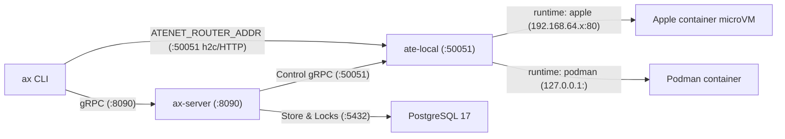

# `ate-local`: Local Agent Substrate on Apple Container & Podman

> **OKF v0.2 Track Metadata & Lineage**: [`okf/ate-local.md`](../okf/ate-local.md) · **Bundle Index**: [`okf/index.md`](../okf/index.md)

This experiment track prototypes and benchmarks **`ate-local`** ([`google/ax#602`](https://github.com/google/ax/issues/602)), a lightweight Go control and data plane implementing the **Agent Substrate Control gRPC API** (`go.ate.dev/substrate/api/ateapi/v1.ControlServer`, `v1.0.0`) plus an embedded **`atenet-router`** (`ate-target-actor` HTTP/1.1 + HTTP/2 `h2c` reverse proxy with wake-on-request), backed by either macOS's native **Apple `container`** runtime (`/usr/local/bin/container`) or **Podman** (`podman`).

With `ate-local`, an AX developer on an Apple Silicon Mac can boot the full AX stack (`postgres:17-alpine` + `ate-local` + `ax-server`) in ~3.3 seconds, run isolated Linux sandbox tasks across Apple `container` microVMs (`192.168.64.x` `vmnet` bridge) and Podman (`127.0.0.1:<hostPort>`), and promote stateful tasks across clusters with zero Kubernetes (`kind`), Docker Desktop, gVisor, Envoy, or cloud infrastructure.

---

## Documents in This Folder

| Document | Purpose |
|---|---|
| [`PROPOSAL.md`](/ate-local/PROPOSAL.md) | Full architectural proposal, Substrate concept mapping, developer glidepath analysis, and Apple Silicon performance benchmarks. |
| [`TESTING.md`](/ate-local/TESTING.md) | Step-by-step verification guide: automated unit tests, live Apple `container` microVM integration tests, and full local stack walkthrough. |
| [`AX-SETUP.md`](/ate-local/AX-SETUP.md) | Post-PR `#603` (`ax local`) comparison, what remains unique to `#602`, and how `ate-local` plugs behind `ax local --backend=ate-local` while separating setup from daemon lifecycle. |
| [`LOCAL-BACKEND.md`](/ate-local/LOCAL-BACKEND.md) | Step-by-step timing of upstream Kind-based `ax local` (v0.4.0-rc.1) next to `ate-local`, root causes for slow cold starts and resumes (`#689`), and the `local.Backend` vs Kind-optimization options. Harness: [`bench/ax-local-timing.sh`](/ate-local/bench/ax-local-timing.sh). |
| [`HERO-DEMO-FEEDBACK.md`](/ate-local/HERO-DEMO-FEEDBACK.md) | Field report & landed follow-ups (`471ca83`, `4ef71a5`, `a7607d4`) on `feat/ate-local-apple-container` from the live 5/5 Hero Demo (`#590` / `#602`). |
| [`archive/prior-proposal.md`](/ate-local/archive/prior-proposal.md) | Archived initial `ate-local` design draft. |
| [`archive/glidepath.md`](/ate-local/archive/glidepath.md) | Archived developer adoption funnel ("glidepath") notes. |

---

## Quick Verification

From your [`ghchinoy/ax`](https://github.com/ghchinoy/ax) checkout on the `feat/ate-local-apple-container` branch:

```bash
cd ~/projects/ax
git checkout feat/ate-local-apple-container

# 1. Run automated unit + live Apple container microVM tests
go test -v ./internal/atelocal/...

# 2. Boot the single-cluster stack (PostgreSQL 17 + ate-local :50051 + ax-server :8090)
#    (or run `make local-multi-up` for dual-cluster Apple container + Podman)
make local-up
source .ax-local/env
make local-status
```

Once the local stack is running, continue to [`/swarm/README.md`](/swarm/README.md) to run multi-agent swarm recipes (`01`–`08`), [`/genkit/README.md`](/genkit/README.md) to run the declarative Genkit Go runner (`#538`), or [`/hero-demo/README.md`](/hero-demo/README.md) to run the 5/5 live Hero Demo (`#590` / `#602`).

---

## Appendix: How `ate-local` Setup & Runtime Execution Work

On `ghchinoy/ax:feat/ate-local-apple-container`, setup happens at two distinct layers: **local stack bootstrap** (`examples/ate_local/local-stack.sh`) and **sandbox + warm-workspace execution** inside the Go `ate-local` daemon (`internal/atelocal`).



### A. Layer 1: Stack Bootstrap (`examples/ate_local/local-stack.sh`)

Running `make local-up` (single cluster) or `make local-multi-up` (dual-cluster Apple `container` + Podman) executes five ordered steps:

1. **Pre-flight & Port Checks:** Verifies the container CLI responds and ensures ports `5432` (PostgreSQL), `50051` (`ate-local`), and `8090` (`ax-server`)—plus `50052` / `8091` in `multi-up`—are not held by unrelated processes.
2. **Binary Compilation:** Builds host `ax`, `ax-server`, and `ate-local` into `.ax-local/bin/`, and cross-compiles `GOOS=linux GOARCH=arm64` `ax-task-runner` into `.ax-local/bin/linux_arm64/ax-task-runner` for bind-mount injection into stock Linux images.
3. **Config & Environment Generation:** Writes `.ax-local/ate-local.yaml` (`runtime`, `snapshot_dir`, `container_prefix`, and the `default` template mounting `ax-task-runner`) alongside `.ax-local/env` (`AX_SERVER`, `ATENET_ROUTER_ADDR`, and Cluster A/B variables).
4. **PostgreSQL Readiness:** Starts `postgres:17-alpine` on `127.0.0.1:5432` and polls `psql -U ax -d ax -c "SELECT 1"` (avoiding initdb startup races; `multi-up` also ensures a separate `ax_cluster_b` database).
5. **Ordered Daemon Startup:** Starts `ate-local` (`:50051`) and waits for its listener before starting `ax-server` (`:8090`, `--metrics-addr 127.0.0.1:9090`) pointed at `--substrate-endpoint 127.0.0.1:50051 --substrate-plaintext` with `ATENET_ROUTER_ADDR=127.0.0.1:50051`. In `multi-up`, Cluster B boots `ate-local-b` (`:50052`, `runtime: podman` when installed) and `ax-server-b` (`:8091`, `--metrics-addr 127.0.0.1:9091`), sharing `.ax-local/snapshots/`.

### B. Layer 2: Apple `container` vs. Podman Inside `internal/atelocal`

Both backends implement the `ContainerRunner` interface (`internal/atelocal/runner.go`), allowing `internal/atelocal/server.go` to share the same `ControlServer`, `Tag`, snapshot, and `atenet-router` logic:

| Capability | Apple `container` (`runtime: apple`) | Podman (`runtime: podman`) |
|---|---|---|
| **CLI Translation** | Invokes `/usr/local/bin/container` directly (`run --progress none`, `delete --force`); auto-detects a local `ghcr.io/apple/containerization/vminit` tag if the default `vminit` snapshot is missing. | `translatePodmanArgs` strips Apple-specific `--progress` and `--init-image` flags, maps `delete` to `rm`, and injects `-p 127.0.0.1::<port>` when no publish flag is set. |
| **Actor Networking (`WorkerPodIps[0]`)** | Reads the microVM's direct `vmnet` bridge IP (`192.168.64.x`) from `container inspect`. Readiness probes and `atenet-router` dial `192.168.64.x:80`. | Reads `127.0.0.1:<hostPort>` from `podman inspect` (`NetworkSettings.Ports`) so host callers reach inside the Podman Machine VM (macOS) or rootless network namespace (Linux). |
| **Embedded `atenet-router` (`ax ssh` & A2A)** | Multiplexes HTTP/1.1 and `h2c` on `:50051`; requests carrying `ate-target-actor: <atespace>/<actor>` wake suspended actors on demand and proxy to `192.168.64.x:80`. | Identical router multiplexer (e.g., `:50052` on Cluster B), waking suspended Podman actors on demand and proxying to `127.0.0.1:<hostPort>`. |
| **Runner Injection** | Bind-mounts host `linux_arm64/ax-task-runner` to `/usr/local/bin/ax-task-runner` (and mirrors onto `/opt/ax/ax-task-runner` when `ax-server` sets `--runner-volume-image` per `#620`) on stock images (`debian:12`, `python:3.12-slim`); skips `/usr/local/bin` override for `*/ax-images/*` repositories that bundle a multi-arch runner. | Same `-v <host>/ax-task-runner:/usr/local/bin/ax-task-runner` (and `/opt/ax/ax-task-runner`) bind mount; on macOS Podman Machine, the host path must reside under a VM-shared directory such as `/Users` or `/var/folders`. |
| **Warm `Workspace` `spec.setup` & Snapshots** | When a task binds a `Workspace` with `spec.setup` and no `<ws>-warm` `Tag` archive exists yet, `ensureWarmWorkspaceTag` runs a short-lived setup container (`spec.profile.image` or `alpine/git`) with `-v <stageDir>:/workspace`, waits for `.ax/initialized`, and writes `tags/<ws>-warm.tar.gz`. Before `ResumeActor` boots the task container, `stagePreBootWorkspace` extracts the actor or warm-tag archive into `workdirs/...` and mounts `-v <hostDir>:/workspace` so files exist at `T=0` before PID 1 starts. `SuspendActor` archives `/workspace` (falling back to the staged host dir if a batch container already exited), and `DeleteActor` cleans up staged `workdirs/` and actor snapshots while preserving warm `Tag` archives. | Identical — `ensureWarmWorkspaceTag`, `stagePreBootWorkspace`, `SuspendActor`, and `DeleteActor` invoke `s.runner.Run`, so Podman executes the same pre-warm, pre-boot `-v <hostDir>:/workspace`, snapshot fallback, and cleanup lifecycle. |

### C. Current `local-stack.sh` Operational Notes for Standalone Podman

While the **`ate-local` Go daemon** (`cmd/ate-local --runtime podman`) runs standalone against Podman on both macOS and Linux, the shell helper `examples/ate_local/local-stack.sh` currently assumes a macOS host with Apple `container` installed:
1. `check_prereqs()` checks `uname -s == Darwin` and `container list`, even if `AX_LOCAL_RUNTIME=podman`.
2. `start_postgres()`, `cmd_down()`, and `cmd_logs postgres` manage the `postgres:17-alpine` container via Apple `container` rather than `podman` (`cmd/ax-server` always requires a PostgreSQL `--store` URL).
3. `build()` cross-compiles the injected `ax-task-runner` binary with `GOARCH=arm64` rather than detecting `amd64` vs. `arm64` for x86_64 Linux Podman hosts.
4. CLI commands connect via `AX_SERVER` and `ATENET_ROUTER_ADDR` exported by `source .ax-local/env`.
