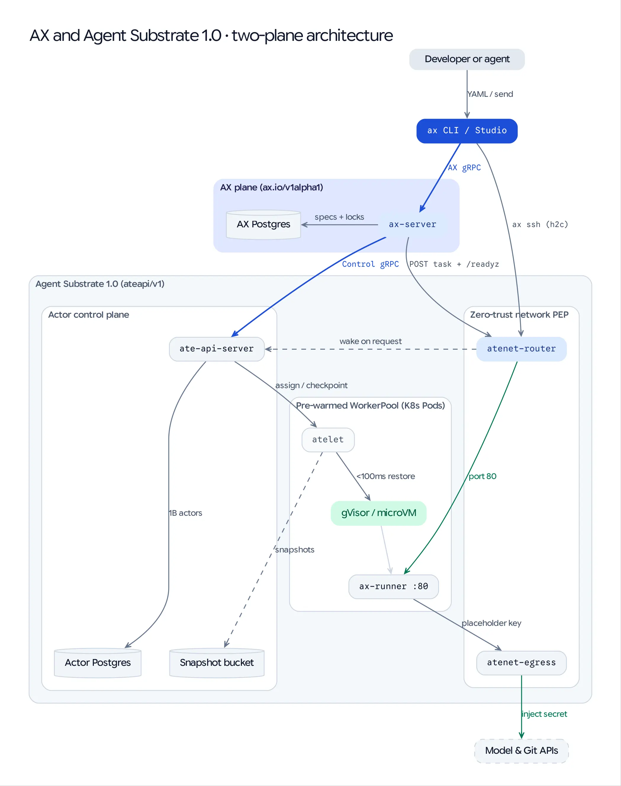

# 1. Why Two Control Planes? The Agent Substrate 1.0 & AX Mental Model

At first glance, newcomers to AX often wonder why running a single sandboxed command involves **three** layers—Kubernetes, Agent Substrate, and AX—and **two** separate PostgreSQL databases. Understanding the scale target of Agent Substrate immediately explains why each boundary exists.

<picture>
  <source media="(prefers-color-scheme: dark)" srcset="diagrams/01-two-plane-architecture-dark.webp">
  
</picture>

---

## 1. What Problem Agent Substrate 1.0 Solves (The Infrastructure Plane)

Autonomous and interactive agents have an awkward execution profile for standard Kubernetes Pods:
- **Untrusted:** They execute LLM-synthesized code and external tools, requiring VM-grade isolation (`gVisor` `runsc` or Kata/Cloud-Hypervisor microVMs) rather than shared host-kernel `runc` containers.
- **99% Idle, Bursty:** An agent thinks or runs a tool for 2 seconds, then waits minutes, hours, or days on a human review, a CI job, or another agent. Keeping a dedicated Pod alive per session wastes 10x–30x RAM/CPU.
- **High Cardinality:** One sandbox per PR review, support ticket, user chat session, or RL rollout quickly reaches $10^6$–$10^9$ sandboxes—far beyond `etcd`'s single-digit-GB storage ceiling and Pod-scheduler QPS limits.

### Substrate's North Star Targets (`substrate/docs/concepts/architecture.md`)
- **Scale:** **1 billion** total actors (active + suspended) per cluster
- **Throughput:** **1,000 activations/second**
- **Latency:** **< 100 ms p95** wakeup from suspended state to serving traffic

### How Substrate Achieves < 100 ms Wakeup
1. **Decouple `Actor`s from Kubernetes `Pod`s (`WorkerPool`):**
   Kubernetes only manages slow-changing `WorkerPool` Deployments—fleets of pre-warmed, empty sandbox Pods (`ateworker`) waiting for assignments. `Actor` records live in Substrate's PostgreSQL database, never in `etcd`.
2. **Split `ActorTemplate` ("Class") from `Actor` ("Instance"):**
   - **`ActorTemplate` (Immutable, Low-Frequency):** Declares the `@sha256`-pinned container image, entrypoint command, static env, and CPU/RAM limits. Substrate pre-prepares a **Golden Snapshot** and OverlayFS `lowerdir+` layers from the template.
   - **`Actor` (Mutable Lifecycle, High-Frequency):** A lightweight instance bound to an `ActorTemplate` (optionally seeded from a snapshot `Tag`). **Crucially, `CreateActor` accepts no `image`, `command`, or `env` overrides.**
3. **Zero-Trust Edge Mediation (`atenet-router` + `atenet-egress`):**
   - **Inbound (`atenet-router`):** Holds incoming HTTP/gRPC requests carrying `ate-target-actor: <atespace>/<actor>`, asks `ate-api-server` to resume a `SUSPENDED` actor onto any free worker (`atelet`), and forwards the request to port 80.
   - **Outbound (`atenet-egress`):** Sandboxes hold **zero** API keys or cloud tokens. Outbound traffic is default-deny; when an actor's `EgressPolicy` permits a host, `atenet-egress` intercepts TLS (trusted via `/run/ate/egress-trust-bundle/trust-bundle.pem`) and replaces placeholder headers (`Authorization: Bearer placeholder`) with real secrets fetched outside the sandbox.

---

## 2. What Problem AX Solves (The Agent Application Plane)

Agent Substrate is deliberately **agent-framework agnostic** (`Persona #2/#3` in Substrate's architecture guide). Substrate knows nothing about Git repositories, `SKILL.md` directories, Model Context Protocol (MCP) registries, prompts/goals, or multi-turn agent steering.

**AX (`ax.io/v1alpha1`) is the opinionated developer layer (`Persona #3/#4`) above Substrate:**

| AX Primitive | What the Developer Declares | How `ax-server` Maps It Onto Substrate `1.0` |
|---|---|---|
| **`Profile`** *(embedded on `Task` / `Workspace`)* | `@sha256` container image (or existing `ateTemplate`), CPU/RAM limits | Content-addressed shared `ActorTemplate` (`ax-<16-char-sha256>`), plus optional read-only `/opt/ax/ax-runner` volume (`#620`). |
| **`Task`** | `profile`, `commands` or `goal.text`, `env`, `config`, `workspace`, `gateway`, `debug` | **1 `Actor`** (named after the task) in the same `atespace`. Launched/steered via inbound HTTP/gRPC on port 80 (`#688`, `#692`). |
| **`Workspace`** | `setup` (`git` clones, inline `files`, `skills`, `commands`) + `mcp` servers | Materialized inside the task's `/workspace` on maiden boot by `ax-runner` (`#696`), with loopback discovery on `127.0.0.1:8099`. |
| **`Gateway`** | Outbound `http` / `https` (with secret header injection) / `tlsPassthrough` rules | Copied once onto the actor's `default` `EgressPolicy` while suspended (`#585`). |
| **`ForkTask`** (`ax fork`) | Branch a follow-up task from a parked task's filesystem state (`#669`) | `SuspendActor` $\rightarrow$ `CreateTag` $\rightarrow$ `CreateActor(source_tag)`. |

### Why AX Uses Its Own PostgreSQL Instead of Kubernetes CRDs (`DESIGN.md`)
If AX stored `Task`s as Kubernetes CRDs, `etcd` would cap AX at ~50,000 tasks—throwing away 99.99% of Substrate's 1B-actor capacity. Instead, `ax-server` stores only **what AX owns** (declarative specs and per-resource distributed lease locks) in PostgreSQL, and reads live `Actor` state and `actorUid` directly from Substrate (`#515`, `#556`, `#695`).
