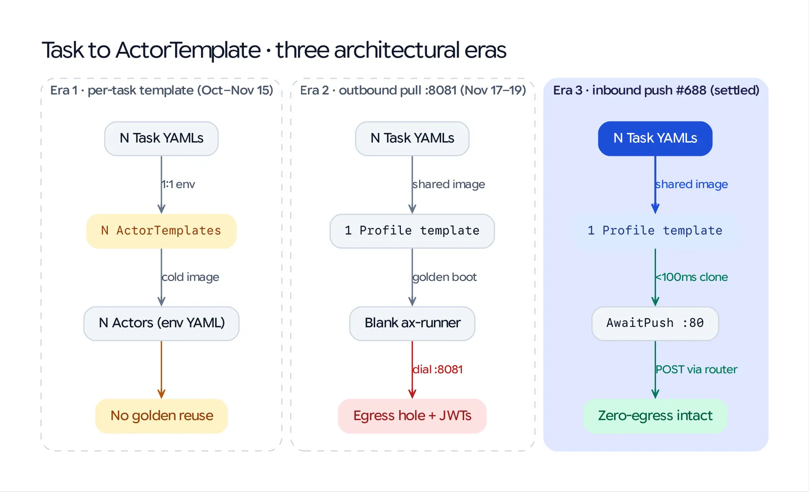
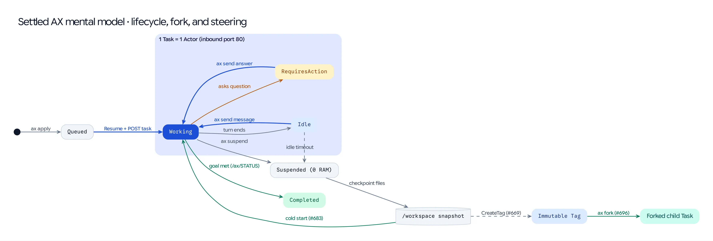

# 2. The Template-vs-Task Impedance Mismatch & AX's Three Pivots

Why did AX experience intense architectural churn immediately after Agent Substrate shipped `v1.0.0` on **November 5, 2026**?

Substrate `1.0` did not break AX's gRPC calls—instead, **Substrate `1.0` froze its API contract in stone**, forcing AX to confront a fundamental impedance mismatch between **Substrate's immutable-template actor multiplexer** and **AX's per-task Kubernetes-Job-like UX**.

---

## 1. The Core Seam: `CreateActor` Has No Per-Instance Config

- **What AX users write:** Every `Task` manifest specifies unique per-task parameters (`spec.commands`, `spec.goal.text`, `spec.env`, `spec.config`, `spec.workspace`).
- **What Substrate `1.0` provides:** `CreateActor` takes *only* an `ActorTemplate` reference (and optional `source_tag`). Container `image`, `command`, and `env` live **exclusively** on the immutable `ActorTemplate` so Substrate can pre-build a reusable Golden Snapshot.

Over three weeks in November 2026, AX tried three distinct architectures to bridge that gap:

<picture>
  <source media="(prefers-color-scheme: dark)" srcset="diagrams/02-template-actor-pivots-dark.webp">
  
</picture>

### Era 1: One `ActorTemplate` per `Task` *(Oct – Nov 15)*
- **How it worked:** `TaskReconciler` hashed `AX_TASK_YAML` + `AX_WORKSPACE_YAML` into `ActorTemplate.containers[0].env`, minting a dedicated `<task>-tmpl-<hash>` template for every task.
- **Why it broke on Substrate `1.0`:**
  1. **Zero Golden-Snapshot Reuse:** 10,000 tasks meant 10,000 distinct `ActorTemplate`s—defeating Substrate's image/snapshot caching.
  2. **Golden-Boot Side Effects (`google/ax#427`, `#428`):** Substrate boots a template's container once *without* actor egress to capture its golden snapshot (`agent-substrate/substrate#3875`). Baking `spec.commands` and `git clone` into the template caused tasks to run—and fail—inside the golden boot!

### Era 2: Shared `Profile` Template + Outbound `:8081` Pull *(Nov 17–19)*
- **How it worked:** Tasks sharing `(image, cpu, memory)` shared one `Profile` `ActorTemplate` (`ax-<hash>`). Because the container booted *blank* (not knowing which `Task` it was), `ax-runner` dialed *out* to `ax-server:8081` (`ClaimAssignment` / `ReportEvents`) authenticated by an OIDC Actor JWT injected by `atenet-egress` (`#591`, `#633`–`#639`).
- **Why it blew up in 72 hours (`+6,252` LOC):**
  1. **Punched a Hole in Zero-Egress Security:** Even tasks with *no* `Gateway` now required an outbound `EgressPolicy` rule to reach `ax-server:8081`.
  2. **Accidental Distributed-Systems Complexity:** Required a second HTTP listener, `NetworkPolicy` exceptions (`#631`), OIDC JWKS discovery/verification, `/run/ate/actor-uid` token binding, and run-attempt sequence fencing in Postgres.

### Era 3: Shared `Profile` Template + Inbound Port-80 Push (`#688`, merged `2ede873`) *(Settled, Nov 20–22)*
- **How it works:** Keep shared `Profile` `ActorTemplate`s (`ax-<hash>`), delete `:8081` and OIDC JWTs (`-6,252` LOC), and **flip the network arrow 180 degrees**:
  1. `ax-runner` boots in `AwaitPush` mode on port 80 (`/readyz` = `200`, `/readyz?check=workspace` = `503`).
  2. `ax-server` (`TaskReconciler.Resume`) pushes `POST /runner/v1alpha1/task` **inbound** over port 80 (via `workerAddr` or `atenet-router` `ate-target-actor`) and polls `/readyz?check=workspace`.
- **Why Era 3 sticks:** It swims *with* Substrate's native inbound router path, restores strict zero-egress on tasks without a `Gateway`, and needs zero background queues across multiple `ax-server` replicas.

> **Where This Goes Next — Substrate `v1.1` ([`agent-substrate/substrate#3876`](https://github.com/agent-substrate/substrate/issues/3876)):**
> `/runner/v1alpha1/{task,setup}` is intentionally marked internal to AX for Substrate `1.0` while `substrate#3876` (*Per-actor environment variables / configuration*) lands in Substrate `v1.1`. Rather than mutating `process.env` (which breaks golden memory snapshots), `substrate#3876` proposes projecting a bounded per-actor key-value map onto Substrate's host-regenerated **`/run/ate/...` `SystemInfo` volume**—allowing shared golden templates to pass per-actor launch config on disk at `T=0` without needing either outbound pull *or* an initial HTTP push!

---

## 2. Three Companion Simplifications That Completed the Reset

Alongside `#688`, `@rakyll` locked in three companion invariants that make the AX programming model clean and predictable:

<picture>
  <source media="(prefers-color-scheme: dark)" srcset="diagrams/03-settled-task-lifecycle-dark.webp">
  
</picture>

1. **Cold-Start Resume Invariant (`google/ax#683`):**
   Even though Substrate's README highlights gVisor RAM checkpointing, `SNAPSHOT_FIDELITY_MEMORY` is only a best-effort hint (and open TLS sockets to LLM APIs die across hibernation anyway). `#683` makes *"every resume is a cold process start over the snapshotted filesystem"* an explicit AX invariant—eliminating dual memory-vs-disk code paths.
2. **Stateless `Workspace` + `ForkTask` Branching (`google/ax#696` & `#669`):**
   Giving `Workspace` its own hidden setup actor (`#592`/`#651`) froze time-sensitive MCP registries, skills, and Git refs at creation time and doubled lifecycle complexity. `#696` restores **"1 `Task` = 1 `Actor`"** (`ax-runner` resolves `Workspace` fresh on task startup) and directs "set up once, branch N times" workflows to explicit **`ax fork task`** (`#669`), which snapshots a parked task into a Substrate `Tag` and seeds child actors via `source_tag`—with optional `Gateway` narrowing on fork so a setup task can use repository-clone credentials that forked runtime tasks never inherit.
3. **Conversational `TaskService` Over One-Shot Exit Codes (`google/ax#690` & `#692`):**
   Real agents pursue goals across multiple turns (`Working` $\leftrightarrow$ `RequiresAction` / `Idle` $\leftrightarrow$ `Suspended`), finishing when the *goal* is met (`/ax/STATUS` JSON, `#690`) rather than when a shell PID exits—steered inbound via `TaskService` (`Send`, `List`, `Watch`, `#692`).
