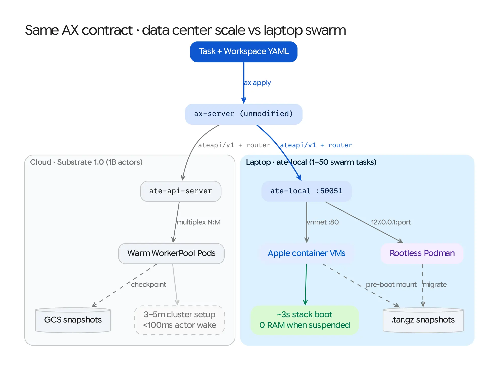

# 3. From 1-Billion-Actor Data Center to 3-Second Laptop Swarms (`ate-local` Learnings)

A natural question arises once you see Agent Substrate's 1-billion-actor design: **Does a developer iterating on an agent—or running a 10-to-30-task multi-agent swarm on a MacBook—need the entire Kubernetes + `WorkerPool` + Envoy + OpenFGA stack locally?**

And looking back across six tracks of experiments (`ate-local`, `swarm/01..08`, `genkit`, `dgem`, `agy`, and `hero-demo`), **how well did our `ate-local` + Apple `container` explorations align with Substrate `1.0` and AX as both evolved?**

<picture>
  <source media="(prefers-color-scheme: dark)" srcset="diagrams/04-datacenter-vs-laptop-dark.webp">
  
</picture>

---

## 1. Why Data-Center Multiplexing Hurts on a Laptop (`google/ax#689`)

In a multi-tenant cloud cluster, pre-warming `WorkerPool` Pods, running `podcertificate-controller` SPIFFE CAs, `ate-api-server`, `atenet-router`, `atenet-egress`, `rustfs`, and two PostgreSQL StatefulSets amortizes across millions of actors.

On a single developer's laptop (`ax local start` on Kind, `#603`), that same stack:
- Requires a rootful Linux VM with **kernel $\ge 6.8$** (`OverlayFS lowerdir+` via `fsconfig`) and **6–8 GiB RAM** before running a single task;
- Takes **~2 minutes (128–129 s measured on Apple M5, and 3–5 minutes in [`google/ax#689`](https://github.com/google/ax/issues/689))** on a fresh start while 12+ control-plane and worker Pods converge sequentially—and **170–362 s** on `stop` $\rightarrow$ `start` while pod-certificate volumes wait out kubelet mount backoff (see step-by-step breakdown in [`ate-local/LOCAL-BACKEND.md`](../ate-local/LOCAL-BACKEND.md));
- Keeps `WorkerPool` Pods idling in VM memory even when no tasks are running.

By contrast, on Apple Silicon macOS, **`Virtualization.framework` (`Apple container`) *is* already a sub-second microVM hypervisor**. Implementing Substrate's `ateapi/v1.ControlServer` + `atenet-router` (`h2c`) directly against `Apple container` and rootless `podman` (`ate-local`, [`google/ax#602`](https://github.com/google/ax/issues/602)) boots the entire AX stack in **~3 seconds** while running **100% unmodified `ax` and `ax-server`**.

---

## 2. Six Empirical Learnings from Running 10–50 Swarm Tasks on `ate-local`

Even with **1 human tenant** on a laptop, multi-agent workflows (`swarm/03-seed-matrix`, `swarm/04-review-panel`, `dgem/03-specialist-router`, or `ax fork` speculative branches) routinely spawn **10 to 50 tasks**. Building and stress-testing `ate-local` surfaced six concrete systems lessons—nearly all of which independently converged on the exact same invariants Substrate `1.0` and AX `v0.4` later formalized:

### Learning 1: Laptop Swarms Need Scale-to-Zero Oversubscription Just Like Cloud Clusters
- **What happened:** Each Apple `container` microVM boots its own lightweight Linux kernel (`vminit`), reserving 512 MiB–2 GiB of guest memory. Running 25 specialist/swarm tasks simultaneously on a 24 GiB MacBook saturates unified memory; suspending idle tasks (`container stop` $\rightarrow$ **0 CPU, 0 RAM**) and waking them on demand through `ate-local`'s embedded `atenet-router` (`dgem/03-specialist-router`) let dozens of specialist agents coexist effortlessly when only 2–4 are active at once.
- **Alignment:** **100% aligned** with Substrate's core multiplexing thesis (`N` actors over `M` active sandboxes) and AX `#692` (idle auto-suspend + wake on message).

### Learning 2: Pre-Boot Filesystem Hydration (`T=0`) Beats Post-Boot `exec` Restore
- **What happened:** Early `ate-local` restored `.tar.gz` snapshots via `container exec ... tar -xzf` *after* `container run`. That raced with PID 1 (`ax-runner` calling `SetupWorkspace` at `T=0`), causing stock `python:3.12-slim` (no `git` binary) in Hero Demo Step 4 to attempt `git init` and fail (`ate-local/HERO-DEMO-FEEDBACK.md`). Extracting the snapshot onto a host workdir and bind-mounting `-v <hostDir>:/workspace` **before** container boot eliminated the race completely.
- **Alignment:** **100% aligned** with Substrate `atelet` (which mounts hydrated volume layers before guest init starts) and AX `#683` (*every resume is a cold process boot over an already-restored `/workspace`*).

### Learning 3: Runner Binary Injection Must Not Collide With `/usr/local/bin/` Hardlinks
- **What happened:** Mounting `/usr/local/bin/ax-task-runner` into stock images (`debian:12`, `python:3.12-slim`) enabled zero-Dockerfile tasks, *until* we ran `*/ax-images/*` where `/usr/local/bin/ax-task-runner` was hard-linked to `/usr/local/bin/ax-agent`—clobbering the agent binary (`agy/GUIDE.md`, `ghchinoy/ax@54718a7`)!
- **Alignment:** Upstream hit the **exact same collision** days later and solved it cleanly in `#619`–`#621` by mounting the runner read-only at **`/opt/ax/ax-runner`** and handing task specs as files to the image's launcher.

### Learning 4: Logical Actor Routing (`atenet-router`) Abstracts VM Network Asymmetry
- **What happened:** Apple `container` gives every microVM a routable macOS `vmnet` IP (`192.168.64.x:80`), whereas rootless `podman` on macOS runs inside a `libkrun` VM reachable only via published host ports (`127.0.0.1:<ephemeralPort>`). Embedding an HTTP/1.1 + `h2c` `atenet-router` (`ate-target-actor` header) inside `ate-local` made `ax ssh`, `/readyz`, A2A JSON-RPC, and `#688` task pushes work identically across both runtimes.
- **Alignment:** **100% aligned** with AX `#587` (dropping `TaskStatus.worker_ip` from `ax ssh` in favor of `atenet-router`) and `#688` (`actorhttp.go` inbound push).

### Learning 5: Hypervisor Guest-Init Drift Mirrors Substrate's `SandboxConfig`
- **What happened:** Upgrading the macOS `container` CLI (`0.10` $\rightarrow$ `0.12`) broke container startup when `ghcr.io/apple/containerization/vminit:<tag>` drifted from cached local images, requiring `detectLocalVminitImage` fallback in `internal/atelocal/runner.go`.
- **Alignment:** Directly mirrors why Substrate `1.0` manages hypervisor/kernel/initrd versions explicitly via cluster-scoped `SandboxConfig` assets (`substrate/docs/concepts/sandbox-asset-cache.md`).

### Learning 6: The Two Places Our Explorations *Intentionally* Diverged
1. **Outbound Secret Injection (`atenet-egress` MITM vs. Local `spec.env`):**
   - *Gap:* In `ate-local` v1, `EgressPolicy` RPCs are stored for API parity, but local tasks typically receive `GEMINI_API_KEY` via `spec.env` rather than an outbound TLS-intercepting proxy. In production Substrate, secrets *never* enter `spec.env` (`atenet-egress` swaps placeholder headers outside the sandbox).
   - *Future local option:* A ~150-line optional Go HTTP/CONNECT proxy in `ate-local` reading `EgressPolicy` + macOS Keychain/env secrets would give local developers 100% `Gateway` credential-injection parity too.
2. **Stateful Cross-Cluster `/workspace` Migration (`Move Task` vs. Spec-Only `ax promote` `#694`):**
   - *Divergence:* Upstream chose to keep `ax promote` (`#618`, `#694`) strictly spec-only (no `/workspace` file transfer). For developer inner-loop $\rightarrow$ cloud workflows, streaming uncommitted `/workspace` edits across clusters (`AX Central`'s `Move Task` over dual `ax ssh` pipes) remains a high-value Studio/desktop capability layered cleanly *above* AX without needing core changes.

---

## 3. Alignment Scorecard Summary

| Axis | Early Exploration (`ax-experiments`) | Settled Upstream (`Substrate 1.0` + `AX #683/#688/#696`) | Verdict |
|---|---|---|---|
| **Resume semantics** | Cold process restart over `.tar.gz` `/workspace` | Cold start over snapshotted filesystem (`#683`) | **Exact match** |
| **Control -> Runner direction** | Inbound HTTP/gRPC via `workerIP` & `atenet-router` | Inbound HTTP push on port 80 (`#688`) + `TaskService` (`#692`) | **Exact match** *(after upstream reverted Era 2 Pull)* |
| **Stock image execution** | Host bind-mount of arm64 `ax-runner` | Read-only `/opt/ax/ax-runner` OCI image volume (`#620`) | **Converged** |
| **Reusable setup / branching** | `Tag` snapshots (`CreateTag` + `source_tag`) | `ForkTask` (`#669`) + stateless `Workspace` (`#696`) | **Exact match** |
| **Multi-turn scale-to-zero** | A2A `contextId` on `/workspace` + `Wake & Prompt` | `TaskService` (`Send`/`List`/`Watch` + idle suspend, `#692`) | **Prefigured `#692`** |
| **Cross-cluster data move** | `.tar.gz` shared store + `ax ssh` `tar` pipe (`Move Task`) | Spec-only `ax promote` (`#618`, `#694`) | **Complementary (`AX Central` differentiator)** |
| **Outbound secret PEP** | `EgressPolicy` stored; keys passed via `spec.env` locally | Envoy `atenet-egress` TLS header replacement (`#585`) | **Known local simplification** |
