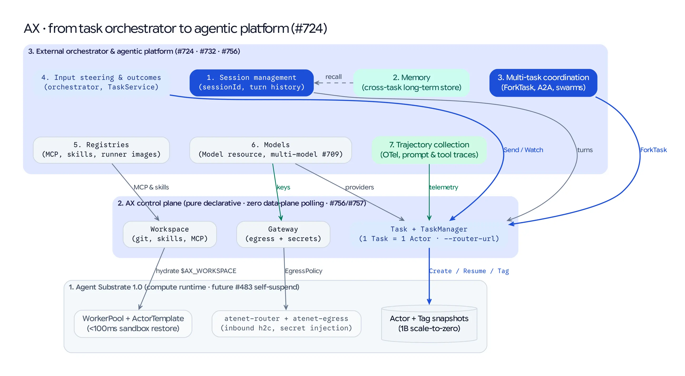

# 4. How AX Differs from Agent Substrate & Grows into an Agentic Platform (`#724`)

[Document 1](./01-substrate-and-ax-mental-model.md) introduced the two-plane split between Agent Substrate and AX, and [Document 2](./02-the-three-pivots.md) traced how AX converged on its `v0.4` task-orchestration contract (`#683`, `#688`, `#696`). A recurring question—captured in **[`google/ax#724`](https://github.com/google/ax/issues/724)**—is *what cleanly separates AX from Agent Substrate long term*, and *how AX grows from a task orchestrator into a full agentic platform* without duplicating Substrate.

<picture>
  <source media="(prefers-color-scheme: dark)" srcset="diagrams/05-agentic-platform-evolution-dark.webp">
  
</picture>

---

## 1. The Clean Layer Boundary: Agent Substrate vs. AX

The shortest way to separate the two projects is by **what each layer knows about**:

- **Agent Substrate knows about *isolated compute*, not agents.** It runs up to 1 billion untrusted sandboxes (`Actor`s) from immutable container classes (`ActorTemplate`s), restores them onto pre-warmed `WorkerPool` Pods in `<100 ms`, checkpoints their state (`Tag`s), routes inbound HTTP/gRPC traffic by logical ID (`atenet-router`), and mediates outbound network access and secret header injection (`atenet-egress`). Substrate deliberately has **no concept** of prompts, LLMs, sessions, memory, MCP tools, skills, or multi-agent graphs.
- **AX knows about *agentic work*, not sandbox plumbing.** AX treats Substrate's `Actor` as its unit of isolated execution (`1 Task = 1 Actor`) and owns every developer-facing and agent-facing concern above the container boundary: declarative specs (`Task`, `Workspace`, `Model`, `Gateway`), workspace hydration (`$AX_WORKSPACE`, `#723`), runner/launcher contracts (`ax-runner` / `ax-launcher`, `#711`), multi-turn interaction, coordination across tasks, model/tool governance, and agent telemetry.

### Responsibility Matrix

| Concern | Agent Substrate `1.0` (`ateapi/v1`) | AX (`ax.io/v1alpha1`) |
|---|---|---|
| **Core primitive** | `ActorTemplate`, `Actor`, `Tag`, `WorkerPool`, `EgressPolicy` | `Task`, `Workspace`, `Model`, `Gateway` (+ emerging `Session`, `Memory`, `Agent`) |
| **Isolation & scheduling** | gVisor / microVM sandboxes, OverlayFS image cache, `<100 ms` wake-on-request | Never schedules Pods or manages hypervisors; delegates execution via `Control` gRPC (`ate-local` swaps the backend locally) |
| **Lifecycle & state** | Actor states (`RUNNING`, `SUSPENDED`, `CRASHED`), durable disk snapshots | Goal-level outcomes (`/ax/STATUS`, `#690`), cold-start resume invariant (`#683`), aligning `TaskState` with `ActorState` (`#708`) |
| **Network & secrets** | SPIFFE mTLS, `atenet-router` request parking, `atenet-egress` TLS secret swap | Translates declarative `Gateway` + `Model` credentials into per-actor `EgressPolicy` rules; zero secrets in `spec.env` |
| **Inside the sandbox** | Boots PID 1 from `ActorTemplate` image with zero opinion on contents | Mounts `/opt/ax/ax-runner` (`#620`), hydrates Git/skills/MCP into `$AX_WORKSPACE` (`#723`), invokes `ax-launcher` (`#711`) |
| **Multi-turn & agent semantics** | None—an actor is just an HTTP/gRPC endpoint on port 80 | Sessions, long-term memory, steering (`TaskService`), multi-task coordination, registries, models, and trajectories (`#724`) |

---

## 2. The Seven Pillars: From Task Orchestrator to Agentic Platform

AX starts as a crisp task orchestrator because a cheap, suspendable, strongly isolated `Task` is the hardest foundation to get right. Once `1 Task = 1 Actor` over inbound port 80 is settled, AX grows into an agentic platform along **seven concrete capabilities** listed in [`google/ax#724`](https://github.com/google/ax/issues/724) and [`docs/roadmap.md`](https://github.com/google/ax/blob/main/docs/roadmap.md):

| # | Platform Pillar (`#724`) | Why It Lives in AX (Not Substrate) | Upstream Anchors (`google/ax`) | Proven in `ax-experiments` |
|---|---|---|---|---|
| **1** | **Session management** | Substrate snapshots raw bytes on disk; it has no notion of conversation turns, session IDs, or transcript history across `suspend`/`resume`. AX models multi-turn conversations (`spec.sessionId`, `AX_SESSION_FILE`) so users and harnesses resume coherent threads across cold process restarts (`#683`). | `docs/roadmap.md §5`, `#621` (`AX_SESSION_FILE`), `#670` (Hero Demo Step 3 Turn 2) | [`genkit/`](../genkit/README.md) (persisted A2A `contextId` across `suspend`/`resume`), [`hero-demo/`](../hero-demo/README.md) Step 3 |
| **2** | **Memory** | Per-task `/workspace` snapshots and `Tag`s scope state to a single task lineage. Long-term **Memory** outlives any individual `Task`, giving agents scoped storage and retrieval shared across sessions and tasks without forcing every task to fork one monolithic filesystem. | `docs/roadmap.md §5` (*Sessions and Memory*) | Gap to prototype post-`#692`; complements per-task snapshots & OKF knowledge bundles (`okf/`) |
| **3** | **Multi-task coordination** | Real agentic work fans out into trees and swarms—planning, delegating, retrying, and comparing speculative branches (`docs/concepts.md`). AX layers cheap task branching (`ForkTask` over Substrate `Tag`s), parent-child lineage (`status.parentTask`), and inter-task communication protocols (`Agent` specs, A2A/MCP bridges) atop Substrate's `atenet-router`. | `#669`/`#670` (`ForkTask`), `#696` (stateless `Workspace`), `docs/roadmap.md §2–3` | [`swarm/01..08`](../swarm/README.md), [`genkit/01–02`](../genkit/README.md) (EGM panel & in-cluster MCP$\rightarrow$A2A delegation), [`dgem/03`](../dgem/README.md) (specialist router) |
| **4** | **Input steering** | Autonomous agents are rarely one-shot shell scripts: they pause for clarification, request tool approvals, or accept mid-run course corrections. AX adds structured inbound steering (`TaskService` `Send`/`List`/`Watch`) and canonical goal-level status (`/ax/STATUS`: `COMPLETED`, `FAILED`, `REQUIRES_ACTION`) over port 80—waking suspended actors transparently via `atenet-router`. | `#690` (`/ax/STATUS`), `#692` (`TaskService`), `docs/roadmap.md §3` | [`agy/02`](../agy/README.md) (cascading `dgem` `PreToolUse` gate + live `ax ssh` HITL), [`ax-central`](../okf/ax-central.md) inline HITL approval |
| **5** | **Registries** | Every organization needs governed catalogs of **MCP servers**, **skills** (`SKILL.md`), and **prebuilt runner/agent images** rather than ad-hoc URLs pasted into every prompt. AX resolves registries declaratively in `Workspace` and enforces policy/allowlists before code runs inside the sandbox. | `docs/concepts.md`, `docs/roadmap.md §1, §4, §7`, `#678` (release defaults) | [`genkit/workspace.yaml`](../genkit/workspace.yaml) (skills + MCP), [`ax-images`](../okf/ax-images.md) (`@sha256` multi-arch images), [`ax-central`](../okf/ax-central.md) Image Registry Catalog |
| **6** | **Models** | Binding LLM providers, model IDs, sampling parameters, and rotated API keys as first-class cluster resources (`Model` in `ax.io/v1alpha1`) decouples agent code from credentials and enables **multi-model tasks** (e.g., a fast System-1 policy/router model paired with a frontier System-2 reasoner) with keys injected strictly at `atenet-egress`. | `docs/concepts.md`, `docs/roadmap.md §1`, **`#709`** (`repeated models` on `TaskSpec`) | [`dgem/`](../dgem/README.md) & [`agy/`](../agy/README.md) (System-1 DiffusionGemma policy model + System-2 Gemini/Antigravity coding model) |
| **7** | **Trajectory collection** | Debugging, evaluating, and auditing agents requires structured **trajectories**—correlated prompts, model responses, tool invocations, process executions, and lifecycle state transitions—captured automatically at the `ax-runner` / `ax-server` layer via OpenTelemetry without custom instrumentation inside untrusted agent containers. | `docs/roadmap.md §4` (*Telemetry and Trajectory Collection*), `#665`/`#675` (`ax.task.state_changed`) | [`viz/`](../viz/README.md) (`SCHEMA.md`, `ax-trace`, Lit 3 replay UI, and [`FRICTION-REPORT.md`](../viz/FRICTION-REPORT.md) on `parent_task_id`, `correlation_id`, W3C `traceparent`) |

---

## 3. Why This Architecture Compounds Instead of Bloating

Every one of the seven pillars reinforces the same three invariants from [Document 2](./02-the-three-pivots.md):

1. **Zero new sandbox privilege:** Models inject keys at `atenet-egress`, registries resolve before/at setup, steering flows *inbound* over port 80, and trajectory collection happens at `ax-runner` / `ax-server`—none of the seven pillars requires giving untrusted agent code outbound access to `ax-server` or cluster secrets.
2. **Cold-start & scale-to-zero preserved:** Because Sessions live on `$AX_WORKSPACE`, Memory lives outside the sandbox, and `atenet-router` wakes actors on inbound `TaskService.Send`, a cluster (or laptop running `ate-local`) can keep thousands of idle conversations parked at **0 RAM**.
3. **Substrate stays small and reusable:** Keeping all seven agentic abstractions in AX lets Agent Substrate remain a focused, stable `v1.0` actor runtime usable by non-AX workloads as well.

---

## 4. Upstream-Ready Summary (Draft Material for `google/ax#724`)

When contributing this framing back to `google/ax/docs/` (for example, as a new section in `docs/concepts.md` or a dedicated `docs/architecture.md`), the repository-neutral core fits in three concise blocks:

1. **Division of responsibility:** *Agent Substrate is the zero-trust actor runtime (sandboxes, snapshots, `<100 ms` wake-on-request, inbound routing, and outbound secret injection); AX is the agentic control plane layered above it (`1 Task = 1 Actor`), owning declarative agent environments, runner contracts, and everything semantically aware of LLMs, tools, and users.*
2. **Why AX starts with `Task`:** *A cheap, isolated, suspendable `Task` is the atomic building block. Keeping it small lets a single task be either a standalone job or one node in a coordinated multi-agent tree—and lets AX inherit Substrate's 1B-actor scale-to-zero density by storing specs in PostgreSQL rather than Kubernetes `etcd`.*
3. **Roadmap from orchestrator to agentic platform:** *Built on that task/actor foundation, AX expands into seven platform layers—**Session management**, **Memory**, **Multi-task coordination**, **Input steering**, **Registries**, **Models**, and **Trajectory collection**—while keeping Substrate agent-agnostic and sandboxes default-deny.*
