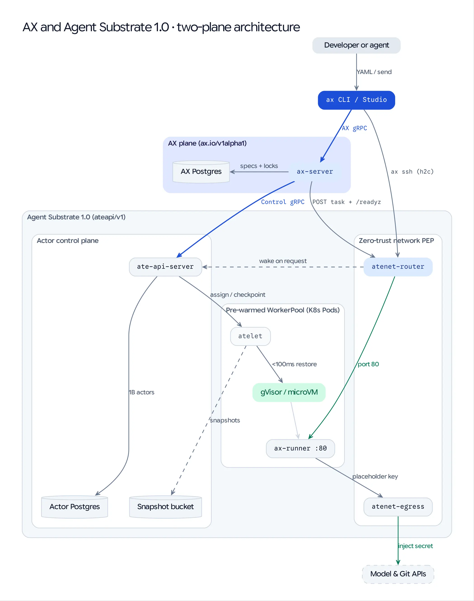

# AX & Agent Substrate 1.0: Developer Mental Model & Architecture Guide

> **OKF v0.2 Card**: [`../okf/concepts.md`](../okf/concepts.md) · **Diagrams**: Rendered with [Lustrous Graphviz](https://github.com/ghchinoy/graphviz-style) (`make -C concepts`)

Developing on **[AX (`google/ax`)](https://github.com/google/ax)** becomes dramatically easier once you understand how **[Agent Substrate 1.0 (`agent-substrate/substrate`)](https://github.com/agent-substrate/substrate)** shapes every layer beneath it—and why AX went through three rapid architectural pivots immediately after Substrate froze `v1.0.0` on November 5, 2026.

<picture>
  <source media="(prefers-color-scheme: dark)" srcset="diagrams/01-two-plane-architecture-dark.webp">
  
</picture>

---

## Guide Index

| Document | Question Answered | Diagram |
|---|---|---|
| **[`01-substrate-and-ax-mental-model.md`](./01-substrate-and-ax-mental-model.md)** | Why do AX and Agent Substrate *both* have PostgreSQL control planes outside `etcd`, and what is the exact division of labor between `ActorTemplate`/`Actor` and `Task`/`Profile`/`Workspace`/`Gateway`? | `01-two-plane-architecture` |
| **[`02-the-three-pivots.md`](./02-the-three-pivots.md)** | How did Substrate `1.0`'s immutable `ActorTemplate` contract collide with AX's per-task YAML ergonomics—and why did AX pivot from Per-Task Templates $\rightarrow$ `:8081` Pull $\rightarrow$ **`#688` Inbound Push**, **`#683` Cold-Start Resume**, and **`#696` `ForkTask`**? | `02-template-actor-pivots` & `03-settled-task-lifecycle` |
| **[`03-datacenter-to-laptop.md`](./03-datacenter-to-laptop.md)** | Why does a 1-billion-actor Kubernetes multiplexer take 3–5 minutes to boot on a laptop (`#689`), what 6 empirical lessons emerged running 10–50 swarm tasks on **`ate-local` + Apple `container`**, and how well did our explorations align with Substrate `1.0` and AX? | `04-datacenter-vs-laptop` |
| **[`04-from-orchestrator-to-platform.md`](./04-from-orchestrator-to-platform.md)** | What is the lasting boundary between Agent Substrate and AX (orthogonal outside task execution, portable across Google / customer clusters / on-prem), and how does AX grow into a 7-pillar agentic platform (**Sessions, Memory, Multi-task coordination, Input steering, Registries, Models, Trajectory collection**, `#724`/`#732`)? | `05-agentic-platform-evolution` |

---

## TL;DR — The Four Settled Rules for AX Developers

1. **One `Task` = One `Actor` (`google/ax#696`):**
   `Workspace` is declarative startup configuration (`git` repos, inline files, skills, MCP servers) resolved fresh inside each task's own sandbox—never a separate long-lived actor. To reuse expensive setup across 10 tasks, run one setup `Task`, suspend it, and branch children with **`ax fork task`** (`#669`, backed by Substrate `Tag`s).
2. **Every Resume Is a Cold Process Start Over `/workspace` (`google/ax#683`):**
   Never assume in-memory variables, open sockets, or child PIDs survive `ax suspend`. Anything an agent harness needs across turns or hibernations (session JSON, git commits, `.ax/STATUS`) **must live on `/workspace`**.
3. **All Control & Data Traffic Flows *Inbound* to Port 80 (`google/ax#688`, `#692`):**
   Untrusted sandboxes never dial `ax-server`. Assignment (`POST /runner/v1alpha1/task`), readiness (`/readyz`), interactive exec (`ax ssh`), outcome (`/ax/STATUS` `#690`), and multi-turn steering (`TaskService` `#692`) all enter through `atenet-router` (`ate-target-actor`) onto `ax-runner` port 80—preserving default-deny zero-egress for tasks without a `Gateway`.
4. **Scale-to-Zero Matters at 20 Laptop Swarm Tasks *and* 1 Billion Cloud Actors:**
   Whether multiplexing 1M tenants onto Kubernetes `WorkerPool` gVisor pods or running a 20-agent review/routing swarm on a 24 GiB MacBook via `ate-local` (`Apple container` microVMs + rootless `podman`), suspending idle sandboxes to **0 RAM** and waking on request via `atenet-router` is the core primitive that makes agentic fan-out practical.

---

## Canonical Upstream Reference Map

### Agent Substrate `1.0` (`agent-substrate/substrate`)
- [**Architecture & Personas** (`docs/concepts/architecture.md`)](https://github.com/agent-substrate/substrate/blob/main/docs/concepts/architecture.md) — 1B actors, <100 ms p95 wakeup, `WorkerPool` CRDs vs `ActorTemplate`/`Actor` DB records.
- [**Request Parking & Wake-on-Request** (`docs/concepts/request-parking.md`)](https://github.com/agent-substrate/substrate/blob/main/docs/concepts/request-parking.md) — How `atenet-router` holds inbound HTTP/gRPC traffic while `atelet` restores an actor.
- [**Sandbox Asset & Image Cache** (`docs/concepts/sandbox-asset-cache.md`)](https://github.com/agent-substrate/substrate/blob/main/docs/concepts/sandbox-asset-cache.md) — OverlayFS `lowerdir+` (`fsconfig`, Linux $\ge 6.7$/$6.8$) and `SandboxConfig`.
- [**Zero-Trust Security & Egress Credential Injection** (`docs/security/security.md`, `docs/guides/egress-credential-injection.md`)](https://github.com/agent-substrate/substrate/blob/main/docs/security/security.md) — SPIFFE mTLS, default-deny egress, and header replacement at `atenet-egress`.
- [**`v1.0.0` Release Notes** (Nov 5, 2026)](https://github.com/agent-substrate/substrate/releases/tag/v1.0.0) — Public `api/ateapi/v1` stability lock, non-root image `USER`/`WORKDIR` (`#3473`), and boot network access (`#2117`).

### AX (`google/ax`)
- [**Control Plane Design** (`DESIGN.md`)](https://github.com/google/ax/blob/main/DESIGN.md) · [**Core Concepts** (`docs/concepts.md`)](https://github.com/google/ax/blob/main/docs/concepts.md) · [**Sandbox & Runner Contract** (`docs/sandbox.md`, `docs/runner.md`)](https://github.com/google/ax/blob/main/docs/runner.md) · [**Networking** (`docs/networking.md`)](https://github.com/google/ax/blob/main/docs/networking.md).
- **Key Architectural Decisions:** [`#563`](https://github.com/google/ax/issues/563) (`v1alpha1` `Profile`/`Gateway`/`Tag`), [`#603`](https://github.com/google/ax/pull/603), [`#689`](https://github.com/google/ax/issues/689) & [`#712`](https://github.com/google/ax/issues/712) (`ax local` Kind, 3–5m cold start & Docker-free runtimes), [`#620`](https://github.com/google/ax/pull/620) (`/opt/ax` runner volume), [`#669`](https://github.com/google/ax/pull/669) (`ForkTask`), [`#683`](https://github.com/google/ax/issues/683) (cold-start resume invariant), [`#688`](https://github.com/google/ax/pull/688) (inbound push runner), [`#690`](https://github.com/google/ax/issues/690) (`/ax/STATUS`), [`#692`](https://github.com/google/ax/issues/692) (`TaskService` steering), [`#696`](https://github.com/google/ax/issues/696) (stateless `Workspace`), [`#709`](https://github.com/google/ax/issues/709) (multi-model `TaskSpec`), [`#723`](https://github.com/google/ax/issues/723) (`$AX_WORKSPACE`), [`#724`](https://github.com/google/ax/issues/724) & [`#732`](https://github.com/google/ax/pull/732) (orthogonal boundary & portable agentic platform vision).
